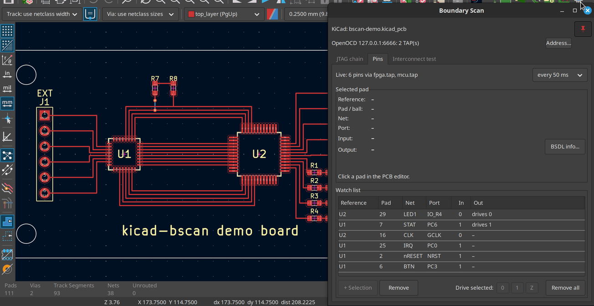
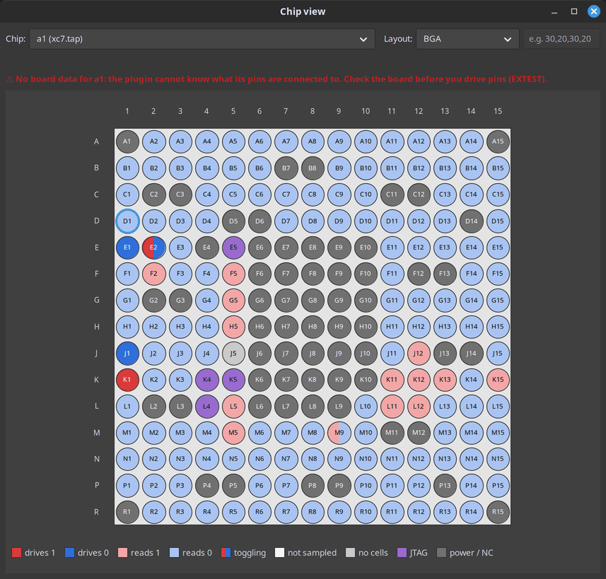
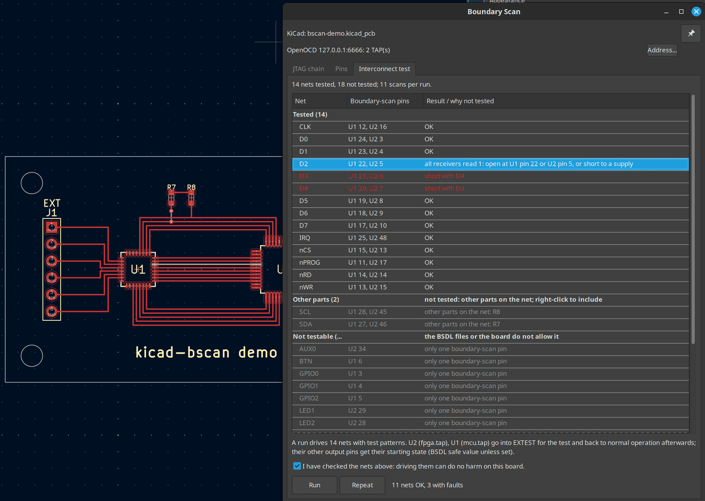

# kicad-bscan – Boundary scan in the KiCad PCB editor

Click a pad in the KiCad PCB editor and see, live, what that pin of the chip is
doing – read through the chip's JTAG boundary-scan register while the board is
running. Watch several pins at once, and for hardware bring-up drive output
pins yourself (EXTEST). The interconnect test checks the connections between
your boundary-scan chips for shorts and opens – what boundary scan was
invented for – and shows faulty nets on the board.

The plugin talks to [OpenOCD](https://openocd.org) (which talks to your JTAG
adapter) and uses the chip's BSDL file to know which bit belongs to which pin.



*The [demo board](demo/README.md), simulated: pads clicked in the PCB editor,
live values in the Pins tab.*

## What it does

- **Live pin values (SAMPLE):** input level and output state (drives 0 / 1 /
  off) of the selected pad, without disturbing the running chip. Selecting a
  pin in the schematic works too: KiCad's cross-probing selects its pad.
- **Watch list:** keep any number of pins visible, independent of the
  selection. Add the pads selected in KiCad with one click (Ctrl+click selects
  several).
- **Drive pins (EXTEST):** set outputs to 0, 1 or Z from the PCB editor, for
  bring-up and for preparing end-of-line tests. Guarded by a mandatory review
  (see [Driving pins](#driving-pins-extest)).
- **Interconnect test:** finds shorts and opens between the boundary-scan
  pins of your chips in well under a second, net by net; click a faulty net
  to select it in the PCB editor (and, by cross-probing, in the schematic; see
  [Interconnect test](#interconnect-test)).
- **Chip view:** a chip of the chain drawn from its BSDL file, every pin
  coloured by its live state – for large BGAs, and for boards not designed
  in KiCad (see [Chip view](#chip-view)).
- **JTAG chain overview:** every TAP OpenOCD knows, with IR length, assigned
  footprint, BSDL file and package, and a check that the BSDL file matches
  the chip (IR length, IDCODE).
- **Finds BSDL files for you:** point it to your BSDL folders; for each chip it
  offers the files whose IDCODE matches, best-fitting package first.

Settings are stored per project in `<project>.bscan.json` next to the KiCad
project. Without a KiCad project (no board open, or no KiCad at all) they go
to a file of their own: by default `no-project.bscan.json` in the user's
configuration folder (`~/.config/kicad-bscan/` on Linux, `%APPDATA%\kicad-bscan\`
on Windows); **Settings file...** opens another one or saves them as a new
one, e.g. one per board.

## Requirements

- **KiCad 9.0 or 10** with the IPC API enabled (see below).
- **OpenOCD** running with the configuration for your adapter and board. The
  plugin connects to OpenOCD's Tcl port (default `localhost:6666`).
- **BSDL files** for the chips you want to look at (from the chip vendor; for
  FPGAs usually shipped with the vendor tools).
- **Linux or Windows.** Tested on Fedora (KiCad 9) and Windows (KiCad 10).

## Installation

The plugin is built from source.

**1. Dependencies** (Fedora):

```sh
sudo dnf install cmake gcc-c++ protobuf-devel protobuf-compiler nng-devel wxGTK-devel json-devel
```

Needed: a C++23 compiler (GCC ≥ 13), wxWidgets ≥ 3.2, Protobuf, NNG,
nlohmann/json ≥ 3.2.

**Windows:** built with [MSYS2](https://www.msys2.org) in its **UCRT64**
environment (start the "MSYS2 UCRT64" shell):

```sh
pacman -S git mingw-w64-ucrt-x86_64-gcc mingw-w64-ucrt-x86_64-cmake \
          mingw-w64-ucrt-x86_64-ninja mingw-w64-ucrt-x86_64-protobuf \
          mingw-w64-ucrt-x86_64-nng mingw-w64-ucrt-x86_64-wxwidgets3.2-msw \
          mingw-w64-ucrt-x86_64-nlohmann-json
```

The steps below are the same in that shell. MSYS2 also has OpenOCD
(`mingw-w64-ucrt-x86_64-openocd`, without the optional extensions).

**2. Source:** libbsdl is a git submodule. Clone with `--recursive`, or
fetch it in an existing clone (also after a pull that moved it):

```sh
git submodule update --init
```

**3. Build and install:**

```sh
cmake -S . -B build
cmake --build build -j
cmake --install build
```

This installs the plugin into the per-user plugin folder of your KiCad
version, e.g. `~/.local/share/kicad/9.0/plugins/` (Linux) or
`Documents\KiCad\10.0\plugins\` (Windows) – the version is taken from
`kicad-cli version`; the configure step prints the folder it uses. To choose
it yourself: `-DKICAD_VERSION=10.0` or `-DKICAD_PLUGIN_DIR=/path/to/plugins`.
(An existing build folder remembers the folder from its first configure; use
a fresh build folder or add `-U KICAD_PLUGIN_DIR`.)

On Windows the install also copies the DLLs the plugin needs (wxWidgets,
Protobuf, NNG, ...) next to `kicad-bscan.exe`; this needs CMake 3.21 or newer.
If a DLL is not found, the install stops and names it.

On Linux the install also adds a hidden `kicad-bscan.desktop` file and the
window icon to `~/.local/share` – some desktops (GNOME on Wayland in
particular) take the taskbar icon only from there. Not wanted:
`-DBSCAN_INSTALL_DESKTOP_FILE=OFF`.

**4. In KiCad:**

1. *Preferences → Plugins*: enable **"Enable KiCad API"** (off by default).
2. Restart KiCad.
3. The PCB editor now has a **Boundary Scan** button in its toolbar.

## Trying it without hardware

[demo/](demo/README.md) has a small KiCad board with two simulated
boundary-scan chips (a microcontroller and an FPGA) and a JTAG simulator for
OpenOCD: pins, EXTEST and the interconnect test work as with a real board.

## Getting started

1. **Start OpenOCD** with your usual configuration, e.g.
   `openocd -f interface/... -f board/...`. The plugin uses OpenOCD's Tcl
   port, which is on by default (port 6666). If your configuration contains
   `tcl_port disabled`, remove that line; if it uses another port, set it in
   the plugin with **Address...**.
2. **Open the board** in the PCB editor and click **Boundary Scan**. The window
   stays open while you work; *pin* (top right) keeps it on top.
   The window has three tabs: **JTAG chain** (setup), **Pins** (live
   values) and **Interconnect test**; the connection lines and the red
   EXTEST bar above them are always visible.
3. **JTAG chain** tab: the table lists the TAPs OpenOCD found. For each chip
   you want to use:
   - **Reference:** type the reference designator (e.g. `U1`), or select the
     footprint in KiCad and click **←**.
   - **BSDL file:** click **...** and choose the file. If you have set up BSDL
     folders and matching files were found, the empty field says so and
     **...** lists them first.
   - **Pin map:** the package, if the BSDL file describes several.
   - **Check** shows whether the BSDL file matches the chip.

   Settings of a TAP that is no longer in OpenOCD's chain stay in the table
   (grey, "not in chain"), e.g. while OpenOCD runs with another
   configuration; **Forget...** in that row removes them.
4. **Pins** tab: **click a pad** of that footprint in KiCad. *Selected pad*
   shows its net, the chip port, and the live input and output values.
5. **Watch list:** select pads in KiCad and click **+ Selection** to keep them
   on the list.

One pin is selected everywhere: selecting rows in the watch list selects
their pads in KiCad and highlights the pin in the chip view; selecting a pad
in KiCad (or a pin in the chip view) selects its row in the watch list, if
it is on the list.

The line at the top of the Pins tab shows what is being sampled and lets you
set the sampling interval. The values are for looking at, not for timing
measurements: depending on the adapter, a few to a few tens of samples per
second are possible.

## Chip view

**Chip view...** (top right) opens a separate window that draws one chip of
the chain with the live state of all its pins: drives 1 / 0, reads 1 / 0
(output off), toggling (drawn half 1, half 0), not sampled; JTAG, power and
pins without boundary-scan cells in their own colours (legend below the
drawing). Choose
the chip at the top; it needs a BSDL file and a reference (JTAG chain tab).



- **Layout:** BSDL files describe pins, not the package, so the layout is
  guessed from the pin names: ball names (A1, AB12) give a BGA grid, numbers
  a quad package with the pins spread evenly over four sides, pin 1 top left,
  counter-clockwise. If that is wrong, set the layout: BGA, quad (optionally
  with the pins per side, e.g. `30,20,30,20` for left, bottom, right, top) or
  dual (SOIC, TSSOP). It is saved per chip.
- **Click a pin:** it becomes the selected pad in the Pins tab (until you
  select something else in KiCad), is selected on the board if the board has
  it, and in the watch list if it is on it. **Ctrl+click** selects several
  pins. Pins selected elsewhere are highlighted if they belong to the chip
  shown (the view does not switch chips by itself). **Right-click:** add the
  selected pins to the watch list, or drive them (EXTEST, with the usual setup
  and review).
- **Without a board** (chip not on the open KiCad board, or no KiCad at all)
  the window says so in red: the plugin cannot know what the pins are
  connected to, so the EXTEST review cannot point out pins on nets either.
  Check the board yourself before you drive pins.

**Without KiCad:** start the plugin directly – it is an ordinary program in
the plugin folder the install step printed, e.g.
`~/.local/share/kicad/9.0/plugins/com.github.danselmi.kicad-bscan/kicad-bscan`
(Linux) or `Documents\KiCad\10.0\plugins\com.github.danselmi.kicad-bscan\kicad-bscan.exe`
(Windows). The KiCad line then says "not connected"; the JTAG chain tab, the
Pins tab and the chip view work as usual (a reference is still needed per
chip: any name), and the settings go to a file of their own (see above).

## Finding BSDL files

**BSDL folders...** (JTAG chain tab, below the table) sets where to look; subfolders
are included (`*.bsd`, `*.bsdl`, `*.bsm`):

- **Your folders** apply to all projects – e.g. your collection of vendor BSDL
  files.
- **Project folders** are stored in the project file – e.g. the folder your
  FPGA tool writes its BSDL file to. Files from there are listed first.

For a chip without a (matching) BSDL file, the plugin offers the files whose
IDCODE and IR length match – one entry per file and package, best fitting
first ("Pads found": how many of the footprint's pads exist in the package).
Nothing is assigned automatically; you always choose.

The first search through a large collection takes a while (e.g. 20 s);
afterwards results come from a cache and files are only read again when they
change. Choosing the same BSDL file again re-reads it – handy when your FPGA
tool regenerated it.

## Driving pins (EXTEST)

> **Warning.** In EXTEST the boundary-scan register drives **all** pins of the
> chip, and the chip's own logic is disconnected from them. A wrong level can
> damage your hardware – think of a pin that drives a power stage, a bridge or
> an LED that is only meant to be pulsed. An FPGA may also lose its clock.
> Use EXTEST for bring-up and test preparation, not on a board doing its job.

**Starting EXTEST** – click **EXTEST...** in the chip's row, or one of the
**0 / 1 / Z** buttons of a pin (selected pad or watch list):

1. **Setup:** choose the state every output pin gets when EXTEST starts:
   *safe (BSDL)* (the vendor's safe value, default), *Z* (off), *0*, *1*, or
   *keep* (what the chip drives right now; only for static levels). The list
   shows the net of each pin; the settings are saved for next time. Filters
   help with large chips: only pins with a net, only pins that change when
   EXTEST starts, and a search for pin, port or net.
2. **Review:** every pin that changes its state is listed. Pins that are
   connected on your board but left at the BSDL default are marked red.
   Conflicts (e.g. pins sharing an output enable that need different states)
   block activation. You confirm with a checkbox before anything is driven.

**While EXTEST is active** a red bar at the top says so and offers **Leave
EXTEST**. Drive pins with the **0 / 1 / Z** buttons of the selected pad, or
**Drive selected** (or right-click) in the watch list; driven pins are marked
with ▶. Changing a pin that shares its output enable with others asks first.

**Safety rules built in:**

- If the connection to OpenOCD is lost, EXTEST is left as soon as it is back,
  and never resumed automatically.
- Closing the window asks whether to return the chips to normal operation.
- If you keep EXTEST when closing, the next session does not touch that chip
  until you decide: **Leave EXTEST**, or **Take over...** (only with an
  OpenOCD that has `jtag cur_ir`, see below) to continue driving the same
  states – or a new plan – without the pins returning to the chip's logic in
  between. Several chips kept in EXTEST are taken over together (needs
  `jtag scan` as well); you choose the states for each in turn.

**Keep OpenOCD quiet while in EXTEST.** Anything else using the JTAG chain
can interrupt EXTEST: OpenOCD's background polling of targets in the same chain
(`poll off` stops it), or an IPDBG server. Each interruption hands the pins
back to the chip's logic for a moment.

- The review warns if background polling is on.
- With an OpenOCD that has `jtag cur_ir` (see below), interruptions are
  detected: EXTEST and your pin states are restored at once, and the red bar
  keeps a warning with the count and time of the last one. A board reset that
  OpenOCD does not see (e.g. a reset button) is not detected, but the next
  scan restores EXTEST all the same.

## Interconnect test

The **Interconnect test** tab checks the soldering between the chips with
BSDL files: every net that connects at least two of their boundary-scan pins
is driven by one pin with a sequence of test patterns while the other pins
listen. A net that reads another net's values is shorted to it; a pin that
does not see its net is open.



*The demo board with a simulated short (D3–D4) and an open (U2 pin 5):
the selected net D2 is highlighted in the PCB editor.*

- **The list** shows every net with a boundary-scan pin, in groups: tested,
  fixed (kept out by starting states), other parts on the net, and not
  testable (only one boundary-scan pin, no pin that can drive, or an output
  enable shared with a pin that would then drive). Before the first run the
  nets to test show "will be tested", afterwards their result.
- **Nets with other parts** (resistors, connectors, other ICs) are not tested
  by default: the test would drive those parts too. Right-click (or
  double-click) such a net to include it after checking what is connected.
- **Starting states are constraints:** a pin with a starting state (EXTEST
  setup) keeps it during the test; its net is not tested. On a chip that is
  already in EXTEST, a pin you set by hand (drive buttons) keeps its state
  the same way. Right-click a fixed net to test it (after a question: its
  starting states are removed, pins set by hand get test patterns and their
  state back afterwards) or to edit the starting states. The EXTEST setup
  dialog shows the same while you edit: its column "Interconnect test" says
  per pin whether its net is tested, and marks the starting states that keep
  a net out.
- **Review:** above **Run** the tab says how many nets are driven, which chips
  go into EXTEST for the test and which nets with other parts are driven;
  tick the checkbox to confirm. Chips enter EXTEST only for the test and
  return to normal operation afterwards; chips already in EXTEST drive what
  they drove before.
- **Run** applies the patterns once; **Repeat** again and again until
  **Stop**, counting faults per net – press on parts or bend the board to
  find intermittent joints. A net that failed stays red; "now OK" shows that
  it passes in the latest run. The next Run or Repeat starts the counters
  from zero.
- **Results:** OK, "short with NET_X", "open at U3 pin 12", or "all receivers
  read 0/1" (open at the driving pin, or a short to GND / a supply). Click a
  net to select it in the PCB editor.

A test that involves several chips needs an OpenOCD with `jtag scan` (see
below); with a standard OpenOCD it runs only if all tested nets connect
pins of one chip.

## Optional OpenOCD extensions

The plugin works with a standard OpenOCD. Two additions make it better and
are used automatically when available (not yet in upstream OpenOCD):

- **`jtag cur_ir <tap>`** ([change 9947](https://review.openocd.org/c/openocd/+/9947)) –
  the instruction OpenOCD last loaded into a TAP. With it, the plugin knows
  whether a chip is really in EXTEST (instead of "probably"), notices EXTEST
  set by other programs, offers *Take over*, and detects interruptions of
  EXTEST.
- **`jtag scan`** ([change 9948](https://review.openocd.org/c/openocd/+/9948)) –
  instruction and data scan as one operation, so nothing else (target
  polling, IPDBG) can change the instruction in between. It scans several
  chips at once, so with it **several chips can be in EXTEST** at the same
  time (e.g. to test the connections between them), and the other chips keep
  being sampled meanwhile.

Both are in review for upstream OpenOCD. To use them now, build OpenOCD with
the two changes applied (each change page offers its patch under
*Download*). Whether your OpenOCD has them: `help jtag` in OpenOCD's console
(telnet port 4444) lists them.

## Troubleshooting

- **No "Boundary Scan" button:** check that the KiCad API is enabled and KiCad
  was restarted after installing; the plugin must be in the plugin folder of
  your KiCad version (`9.0` or `10.0`, see the configure output). KiCad skips
  plugins it cannot load without a message; start it with
  `KICAD_ENABLE_WXTRACE=1 WXTRACE=KICAD_API kicad` to see why.
- **"OpenOCD: not connected":** OpenOCD is not running, its Tcl port is
  disabled (`tcl_port disabled` in the configuration), or it listens on
  another address or port – use **Address...**.
- **Check says the BSDL file does not match:** IR length or IDCODE differ –
  usually a different chip or package revision; the details below the table
  say what differs.
- **Values of a pin show "–":** the pin has no boundary-scan cell for that
  direction (e.g. an input-only pin has no output state).

## Known limitations

- Without `jtag scan` (see above) only one chip at a time can be in EXTEST,
  and while it is, the other chips in the chain are not sampled (their pins
  show "paused"): OpenOCD puts all other chips into BYPASS for every scan,
  which would end EXTEST.
- EXTEST does not mix with other JTAG activity on the chain (target polling,
  IPDBG): it is interrupted, restored and reported (see above).
- "Stay on top" is ignored by some Wayland desktops (GNOME in particular);
  starting KiCad with `GDK_BACKEND=x11` helps.
- Windows: no ready-made package yet.

## License

GPL-3.0-only, see [LICENSE](LICENSE). Included third-party code keeps its
license: libbsdl (MPL-2.0, submodule `third_party/libbsdl/`) and the KiCad API `.proto`
files (GPL-3.0-or-later, `third_party/kicad-api/`).

## Feedback

Problems, questions and ideas: please open an issue in this repository's
issue tracker; pull requests are even better. Ideas already collected are in
[doc/TODO.md](doc/TODO.md) ("Ideas").

## For developers

Build options, tests without hardware (JTAG simulator, fake KiCad server) and
design notes: [doc/DEVELOPMENT.md](doc/DEVELOPMENT.md). Open points:
[doc/TODO.md](doc/TODO.md).
